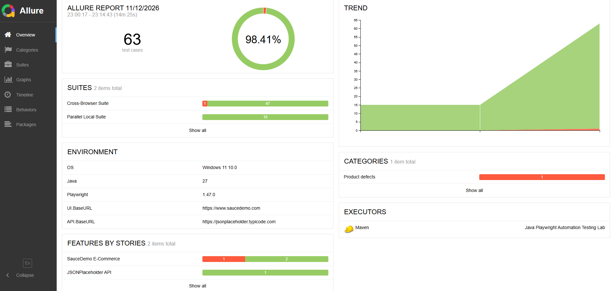

# Java Playwright Automation Testing Lab

UI and API test automation framework built with Java, Playwright, and RestAssured.

## Allure Report — Overview

Cross-browser run: 63 test cases across Chromium, Firefox and WebKit — 98.41% pass rate, Trend graph, Environment panel and per-test browser labels all visible.



## Tech Stack

| Layer | Technology |
|---|---|
| Language | Java 17 |
| Build | Maven |
| UI Automation | Playwright 1.47 |
| API Testing | RestAssured 5.5 |
| Test Runner | TestNG 7.10 |
| Assertions | AssertJ |
| Reporting | Allure |
| Logging | SLF4J + Logback |

## Project Structure

```
src/
├── main/java/com/automation/
│   ├── api/
│   │   ├── models/          User, Address, Geo (POJOs)
│   │   ├── BaseApiClient    RestAssured spec setup
│   │   └── UserApiClient    /users endpoint methods
│   ├── config/
│   │   ├── AppConfig        Typed config accessors
│   │   └── ConfigManager    Singleton properties loader
│   ├── constants/
│   │   └── AppConstants     Shared URL paths and expected strings
│   ├── driver/
│   │   └── BrowserFactory   Creates Playwright browser and context
│   ├── pages/
│   │   ├── BasePage         Shared Playwright helpers (click, fill, etc.)
│   │   ├── LoginPage
│   │   ├── InventoryPage
│   │   ├── CartPage
│   │   └── CheckoutPage
│   └── utils/
│       ├── ScreenshotUtil            Failure screenshot capture
│       └── AllureEnvironmentWriter   Writes OS/Java/URLs to environment.properties
├── main/resources/
│   ├── config.properties    All environment settings (gitignored)
│   ├── config.properties.example  Committed template for local setup
│   └── logback.xml          Log rolling configuration
└── test/java/com/automation/
    ├── base/
    │   └── BaseTest         Playwright lifecycle + browser param + login helper
    ├── listeners/
    │   └── AllureBrowserListener  Tags each test with browser label in Allure
    └── tests/
        ├── ui/              LoginTest, InventoryTest, CheckoutTest
        └── api/             UserApiTest

src/test/resources/
├── testng.xml               Default sequential suite (single browser)
├── testng-crossbrowser.xml  Chromium + Firefox + WebKit in parallel
├── testng-parallel.xml      Single browser, UI classes in parallel
├── testng-shard-ui.xml      GitHub Actions UI shard
└── testng-shard-api.xml     GitHub Actions API shard

.github/workflows/
└── gitactionpipeline.yml    CI pipeline with matrix sharding
```

## Test Coverage

### UI — https://www.saucedemo.com (standard_user)

| Class | Tests |
|---|---|
| `LoginTest` | Successful login, locked-out user error, invalid credentials error |
| `InventoryTest` | Products display, add to cart badge, cart item count |
| `CheckoutTest` | End-to-end checkout flow, missing first name validation |

### API — https://jsonplaceholder.typicode.com/users/2

| Test | Validates |
|---|---|
| `testGetUserReturns200` | HTTP 200 status |
| `testUserIdIsCorrect` | ID = 2 |
| `testUserName` | name = "Ervin Howell" |
| `testUserUsername` | username = "Antonette" |
| `testUserEmail` | email = "Shanna@melissa.tv" |
| `testUserHasAddress` | address and city not null |
| `testGetAllUsersReturnsNonEmptyList` | GET /users returns 200 and non-empty list |

## Running Tests

### Prerequisites

```bash
# 1. Create your local config from the example template
cp src/main/resources/config.properties.example src/main/resources/config.properties
# Then open config.properties and fill in ui.username and ui.password

# 2a. Install Chromium only (sufficient for single-browser runs)
mvn exec:java -e -Dexec.mainClass=com.microsoft.playwright.CLI -Dexec.args="install chromium"

# 2b. Install all browsers (required for cross-browser runs)
mvn exec:java -e -Dexec.mainClass=com.microsoft.playwright.CLI -Dexec.args="install"
```

> `config.properties` is gitignored — credentials never reach the repository.
> For CI, credentials are injected via GitHub Secrets (see [GitHub Actions](#github-actions)).

### Run Commands

```bash
# Default sequential run (all tests, single browser from config.properties)
mvn test

# Cross-browser: Chromium + Firefox + WebKit in parallel (3 threads)
mvn test -DsuiteXmlFile=src/test/resources/testng-crossbrowser.xml

# Local parallel (UI classes in parallel, single browser)
mvn test -DsuiteXmlFile=src/test/resources/testng-parallel.xml

# UI tests only
mvn test -DsuiteXmlFile=src/test/resources/testng-shard-ui.xml

# API tests only
mvn test -DsuiteXmlFile=src/test/resources/testng-shard-api.xml

# Run headless (for CI or background execution)
mvn test -Dheadless=true

# Override browser for a single run
mvn test -Dbrowser=firefox
```

### View Allure Report

```bash
# Generate and open in browser (after mvn test)
mvn allure:serve

# Generate static HTML only
mvn allure:report
# Open: target/site/allure-maven-plugin/index.html
```

### Allure Trend (local)

The trend graph requires history from previous runs:

```bash
# Full command: test → report → save history
mvn test allure:report antrun:run@save-allure-history
```

History is stored in `allure-history/` (gitignored). After at least two runs, the Trend graph will appear in the report.

## Allure Report — Environment Info

The Overview page shows OS, Java version, Playwright version, and target URLs automatically. This is written to `target/allure-results/environment.properties` on the first test setup of each run by `AllureEnvironmentWriter`.

For cross-browser runs, each test in the Allure report is also tagged with a `browser` label (visible in the Suites and Behaviors views), and the three browsers appear as separate suites: **Chromium**, **Firefox**, **WebKit**.

## Configuration

All settings are in `src/main/resources/config.properties`. Any key can be overridden at runtime with `-Dkey=value`.

| Key | Default | Description |
|---|---|---|
| `browser` | `chromium` | `chromium`, `firefox`, or `webkit` |
| `headless` | `false` | Set `true` for CI |
| `slowMo` | `0` | Milliseconds between Playwright actions |
| `timeout` | `30000` | Default element wait timeout (ms) |
| `ui.base.url` | `https://www.saucedemo.com` | UI target |
| `ui.username` | `standard_user` | Login username |
| `ui.password` | `secret_sauce` | Login password |
| `api.base.url` | `https://jsonplaceholder.typicode.com` | API base URL |
| `api.test.user.id` | `2` | User ID for API validation tests |
| `screenshot.on.failure` | `true` | Capture screenshot on test failure |

## GitHub Actions

The pipeline in `.github/workflows/gitactionpipeline.yml` runs on every push to `main`/`develop` and every pull request.

```
Push / PR (default)
├── Runner 1 — UI Shard        (Chromium — LoginTest, InventoryTest, CheckoutTest)
└── Runner 2 — API Shard       (UserApiTest)
         ↓ both finish
     report job — merges results → unified Allure HTML report artifact

Manual trigger with cross_browser = true (optional)
├── Runner 1 — UI Shard        (Chromium)
├── Runner 2 — API Shard       (UserApiTest)
└── Runner 3 — Cross-Browser   (Chromium + Firefox + WebKit in parallel)
         ↓ all finish
     report job — merges all three shard results → unified report
```

To trigger cross-browser in CI: go to **Actions → Automation Tests → Run workflow**, tick **"Run Firefox + WebKit tests"** and click Run.

### Required GitHub Secrets

Go to **Settings → Secrets and variables → Actions → New repository secret** and add:

| Secret name (GitHub) | Value |
|---|---|
| `UI_USERNAME` | `standard_user` |
| `UI_PASSWORD` | `secret_sauce` |

> **Naming rule:** GitHub Secrets do not allow dots (`.`) in names, so the config.properties keys (`ui.username`, `ui.password`) cannot be used directly as secret names. Use underscores and uppercase instead (`UI_USERNAME`, `UI_PASSWORD`).

The pipeline maps them back at runtime:
```
secrets.UI_USERNAME  →  -Dui.username  →  ConfigManager reads ui.username
secrets.UI_PASSWORD  →  -Dui.password  →  ConfigManager reads ui.password
```

### Allure Trend history in CI

The report job caches the `history/` folder from each run and restores it at the start of the next:

```
Run N   → generates allure-results/ → report job saves history/ to cache (key: allure-history-main-N)
Run N+1 → report job restores history/ from cache → injects into allure-results/ → Trend graph updates
```

The cache key uses `github.ref_name` so each branch maintains its own independent trend line. No manual steps needed — it is fully automatic in the pipeline.

### Other pipeline behaviours

- Playwright Chromium is cached between runs (keyed on `pom.xml` hash — invalidated on dependency change)
- Allure HTML report is uploaded as a 30-day build artifact
- Surefire XML reports are uploaded on failure for local debugging
